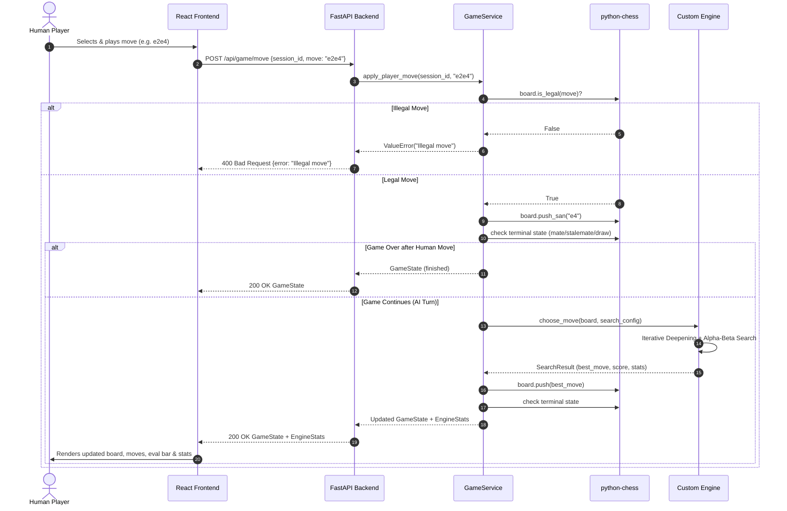

# ARCHITECTURE.md — System Architecture & Component Design

This document describes the architectural design, module decomposition, communication interfaces, data flows, and code contracts for the **Chess AI — Player vs Computer** web application.

---

## 1. System Decomposition & High-Level Architecture

The system is organized into four clearly separated layers:

```mermaid
flowchart TD
    subgraph Client["Frontend (React + TypeScript + Vite)"]
        CB["ChessBoard Component"]
        GC["GameControls Component"]
        MH["MoveHistory Component"]
        EB["EvaluationBar Component"]
        AP["AnalysisPanel Component"]
        APIClient["API Client (fetch/axios)"]
        CB --> APIClient
        GC --> APIClient
    end

    subgraph Server["Backend (FastAPI Web Service)"]
        API["FastAPI REST Routers (/api/game, /api/engine)"]
        Schemas["Pydantic Schemas & DTOs"]
        GS["Game Service (Session & State Management)"]
        Rules["python-chess (Rules Arbiter)"]
        
        APIClient -->|HTTP REST JSON| API
        API --> Schemas
        API --> GS
        GS --> Rules
    end

    subgraph CoreEngine["Custom Chess Engine (Pure Python)"]
        Search["Search Engine (Minimax, Alpha-Beta, Iterative Deepening)"]
        Eval["Heuristic Evaluator (Material, PST, King Safety, Pawns, Phase)"]
        TT["Optimization (Transposition Table & Zobrist Hashing)"]
        Order["Move Ordering & Quiescence Search"]

        GS -->|choose_move(board, config)| Search
        Search --> Order
        Search --> TT
        Search --> Eval
    end

    subgraph OfflineTuning["Offline Tuning Pipeline (Optional)"]
        GA["Genetic Algorithm Optimizer"]
        MatchRunner["Match Runner (Self-Play & Benchmarks)"]
        GA --> MatchRunner
        MatchRunner --> Search
    end
```

---

## 2. Layer Responsibilities & Strict Boundaries

### 2.1 Frontend Layer (`frontend/`)
- **Technology**: React 18+, TypeScript 5+, Vite.
- **Role**: Presentation, visual feedback, user input handling, and analysis visualization.
- **Key Modules**:
  - `ChessBoard.tsx`: Renders the 8x8 chessboard, piece sprites, square highlights (selected, legal targets, last move, check indicator), and pawn promotion modal.
  - `GameControls.tsx`: Triggers New Game, Undo, Restart, Side Selection (White/Black), and manual AI Move trigger.
  - `DifficultySelector.tsx`: Interactive 5-tier difficulty selector (`Beginner`, `Easy`, `Medium`, `Hard`, `Expert`) synchronized in real time with backend game session.
  - `MoveHistory.tsx`: Displays sequential moves in standard algebraic notation (SAN).
  - `EvaluationBar.tsx`: Dynamic vertical centipawn advantage bar calibrated from White's perspective.
  - `AnalysisPanel.tsx`: Displays engine diagnostics (depth, node count, nodes/sec, time elapsed, and evaluation component breakdown).
- **Boundary Restriction**: The frontend never determines move legality or game termination as authoritative. It strictly submits moves to the backend API.

### 2.2 Backend Layer (`backend/`)
- **Technology**: Python 3.12+, FastAPI, Uvicorn, Pydantic v2.
- **Role**: API routing, payload validation, game session lifecycle, and game state arbitration.
- **Key Modules**:
  - `backend/main.py`: Application entry point, CORS middleware, lifespan events, and global exception handlers.
  - `backend/api/schemas.py`: Pydantic models for incoming requests, game states, and analysis responses.
  - `backend/api/routes/game.py`: Endpoints for starting, moving, undoing, restarting, and retrieving game states.
  - `backend/api/routes/engine.py`: Endpoints for on-demand position analysis and engine diagnostics.
  - `backend/game/service.py`: `GameService` maintaining authoritative game sessions using `python-chess.Board`.
- **Boundary Restriction**: The backend does not implement chess search algorithms. It treats `engine` as an independent domain library.

### 2.3 Custom Chess Engine Layer (`engine/`)
- **Technology**: Pure Python 3.12+ (standard library + `python-chess` data structures).
- **Role**: Autonomous decision-making, adversarial search, and static heuristic evaluation.
- **Key Modules**:
  - `engine/search/`:
    - `minimax.py`: Baseline depth-limited Minimax implementation.
    - `alpha_beta.py`: Alpha-Beta search with branch cutoffs ($\alpha \ge \beta$) and TT probing/storing.
    - `iterative_deepening.py`: Progressive deepening with monotonic time budgeting, node limits, and TT reuse.
    - `ordering.py`: Move prioritization (TT move, PV move, promotions, MVV-LVA captures, killer moves, history heuristic).
    - `quiescence.py`: Selective tactical search on capture/promotion branches to overcome the horizon effect.
    - `zobrist.py`: Deterministic 64-bit Zobrist position hashing for pieces, turn, castling rights, and legal en passant files.
    - `transposition_table.py`: Bounded in-memory transposition table with EXACT, LOWER, UPPER bounds, replacement policy, and mate normalization.
    - `time_manager.py`: Dynamic per-move time budgeting factoring move counts, game phase, tactical pressure (checks), safety margins, and PV stability.
  - `engine/difficulty.py`: Authoritative definitions and immutable configuration profiles for 5 difficulty tiers (`beginner`, `easy`, `medium`, `hard`, `expert`).
  - `engine/evaluation/`:
    - `evaluator.py`: Coordinates static evaluation and returns integer centipawns.
    - `material.py`: Base material point counters.
    - `piece_square.py`: Middlegame and endgame positional square bonus tables.
    - `mobility.py`: Piece attack ray and safe destination counting.
    - `king_safety.py`: King zone attack tracking, pawn shield integrity, open files, endgame tapering.
    - `pawn_structure.py`: Independent multi-feature evaluation of passed, connected, protected, doubled, and isolated pawns.
    - `center_control.py`: Center square occupation and pawn/piece control ($d4, e4, d5, e5$).
    - `coordination.py`: Bishop pair, rooks on open/semi-open files, rooks on 7th rank, defended pieces.
    - `game_phase.py`: Non-pawn material game-phase calculation for tapered interpolation.
  - `engine/config.py`: Strongly-typed dataclasses for `SearchConfig` and `EvaluationConfig`.
- **Boundary Restriction**: Completely decoupled from HTTP, web frameworks, and presentation logic.

### 2.4 Offline Tuning Subsystem (`engine/tuning/`)
- **Technology**: Pure Python 3.12+ (standard library + `python-chess`).
- **Role**: Offline optimization of handcrafted static evaluation weights using a Genetic Algorithm (GA).
- **Key Modules**:
  - `individual.py`: Gene specifications (`GeneSpec`) for 12 tunable parameters and `Individual` candidate chromosome representation with bounds validation and `EvaluationConfig` mapping.
  - `dataset.py`: 24 curated training positions (`TRAINING_SUITE`) and 16 held-out validation positions (`VALIDATION_SUITE`) with objective ground-truth strategic criteria.
  - `fitness.py`: Multi-objective `FitnessEvaluator` computing weighted scores across positional alignment (60%), tactical decision quality (35%), and mirrored board symmetry (5%).
  - `selection.py`: Tournament selection (`k=3`) and linear rank selection.
  - `crossover.py`: Blend crossover (BLX-$\alpha$, $\alpha=0.30$) and uniform crossover respecting gene boundaries.
  - `mutation.py`: Bounded Gaussian perturbation mutation with hard parameter clamping.
  - `population.py`: `Population` management, seeded baseline inclusion, top-$K$ elitism preservation, and diversity tracking.
  - `genetic_algorithm.py`: Main GA orchestrator with configurable generations, population size, mutation/crossover rates, reproducible random seeds, dry-run mode, and early stopping.
  - `results.py`: `GAResult` and `GenerationTelemetry` dataclasses with versioned JSON export/import (`export_tuned_config`, `load_tuned_config`).
- **Boundary Restriction**: Strictly an offline tool. Never executed during live gameplay. Default engine evaluation parameters remain 100% handcrafted and unchanged unless explicitly configured.
- **Experiment Tooling**: `scripts/run_ga_tuning.py` CLI script for executing reproducible experiments and exporting configurations to `experiments/`.

---

## 3. Data Flow & Request Lifecycle



---

## 4. REST API Specification & Data Schemas

### 4.1 Endpoints

| Method | Endpoint | Description | Request Body | Response |
| :--- | :--- | :--- | :--- | :--- |
| `POST` | `/api/game/new` | Start a new game session with optional FEN and difficulty. | `NewGameRequest` | `GameState` |
| `POST` | `/api/game/move` | Play a move in UCI or SAN format. | `MakeMoveRequest` | `GameState` |
| `POST` | `/api/game/difficulty` | Update engine difficulty mid-game without resetting board. | `DifficultyUpdateRequest` | `GameState` |
| `POST` | `/api/game/ai-move` | Trigger an automated AI move for active session. | `AIMoveRequest` | `GameState` |
| `POST` | `/api/game/undo` | Undo move(s) from game history. | `UndoMoveRequest` | `GameState` |
| `POST` | `/api/game/restart`| Reset current game to initial position. | `RestartGameRequest` | `GameState` |
| `GET` | `/api/game/state` | Fetch current authoritative game state. | Query: `session_id` | `GameState` |
| `POST` | `/api/engine/analyze` | Request deep analysis on a FEN. | `AnalyzeRequest` | `AnalysisResponse` |
| `GET` | `/api/engine/stats` | Retrieve latest search statistics and performance metrics. | Query: `session_id` | `EngineStats` |

### 4.2 Core Data Models (Pydantic Schemas)

#### `NewGameRequest`
```python
class NewGameRequest(BaseModel):
    initial_fen: Optional[str] = None
    difficulty: Optional[Literal["beginner", "easy", "medium", "hard", "expert"]] = "medium"
```

#### `DifficultyUpdateRequest`
```python
class DifficultyUpdateRequest(BaseModel):
    session_id: str
    difficulty: Literal["beginner", "easy", "medium", "hard", "expert"]
```

#### `AIMoveRequest`
```python
class AIMoveRequest(BaseModel):
    session_id: str
```

#### `MakeMoveRequest`
```python
class MakeMoveRequest(BaseModel):
    session_id: str
    move: str  # UCI format (e.g., "e2e4") or SAN format (e.g., "e4")
```

#### `GameStateResponse`
```python
class GameStateResponse(BaseModel):
    session_id: str
    fen: str
    move_history: List[str]  # SAN notation list: ["e4", "e5", "Nf3"]
    is_terminal: bool
    status: Literal["active", "checkmate", "stalemate", "draw_repetition", "draw_50_moves", "draw_insufficient_material"]
    turn: Literal["white", "black"]
    in_check: bool
    evaluation_cp: Optional[int] = None
    last_engine_stats: Optional[EngineStats] = None
```

#### `EngineStats`
```python
class EngineStats(BaseModel):
    best_move: str
    score_cp: int
    completed_depth: int
    nodes_searched: int
    elapsed_ms: float
    nodes_per_second: int
    principal_variation: List[str]
    termination_reason: str
```

#### `EvaluationBreakdown`
```python
class EvaluationBreakdown(BaseModel):
    total_cp: int
    material_cp: int
    pst_cp: int
    mobility_cp: int
    king_safety_cp: int
    pawn_structure_cp: int
    center_control_cp: int
    piece_coordination_cp: int
    game_phase: float
```

---

## 5. Python Internal Code Contracts

### 5.1 Static Position Evaluation Contract
```python
def evaluate_position(board: chess.Board, config: EvaluationConfig) -> int:
    """
    Evaluates the board state and returns an integer score in centipawns.
    
    Invariants:
    - Strictly White-relative: positive favors White, negative favors Black.
    - Zero represents a neutral or drawn position.
    - Terminal states (checkmate/stalemate) are intercepted by terminal scoring.
    - Must NOT mutate the board.
    """
    ...
```

### 5.2 Move Search Contract
```python
def choose_move(board: chess.Board, config: SearchConfig) -> SearchResult:
    """
    Executes adversarial search to select the optimal legal move.
    
    Invariants:
    - Never mutates the board upon completion or on unexpected exception.
    - Returns a legally validated move available in board.legal_moves.
    - Respects configured time limits, depth limits, and node budgets.
    - Always returns the result from the deepest fully completed iteration.
    """
    ...
```

### 5.3 Quiescence Search Contract (`engine/search/quiescence.py`)
```python
def quiescence_search(
    board: chess.Board,
    alpha: int,
    beta: int,
    ply: int,
    q_depth: int = 0,
    config: Optional[EvaluationConfig] = None,
    context: Optional[SearchContext] = None,
    max_quiescence_depth: int = 8,
    max_check_depth: int = 2,
) -> int:
    """
    Extends search beyond nominal depth for tactically volatile positions.
    
    Invariants:
    - Stand-pat evaluation is strictly evaluated when the side to move is NOT in check.
    - If side to move is in check, stand-pat is strictly prohibited; all legal check evasions are evaluated.
    - Checkmate (-30000 + ply / +30000 - ply) and draws (0 cp) override static evaluations.
    - If max_quiescence_depth is reached while in check, search extends up to max_check_depth
      additional plies to resolve the check via legal evasions, avoiding false quiet cutoffs.
    - If emergency bound (max_quiescence_depth + max_check_depth) is exceeded under check,
      an explicit unresolved check penalty (-300 cp for White, +300 cp for Black) is applied
      rather than treating the position as quiet.
    - Tactical moves include pawn promotions and MVV-LVA ordered captures.
    - Board state is always restored using try...finally: board.pop().
    - Quiescence node count is incremented in SearchContext and respects node and time limits.
    """
    ...
```

### 5.4 Transposition Table Contract (`engine/search/transposition_table.py`)
```python
class TranspositionTable:
    """
    Fixed-size in-memory transposition table indexed by Zobrist hash keys.
    
    Invariants:
    - Bounded memory footprint with O(1) direct-mapped power-of-two table indexing.
    - Full 64-bit key verification prevents hash collision pollution.
    - Mate-score normalization (normalize_score/denormalize_score) ensures exact mate distances across variable plies.
    - Multi-criteria replacement policy prioritizing deeper entries and newer search generations.
    - Terminal and three-fold repetition checks are strictly evaluated prior to TT probing.
    - Path-Dependence Propagation: Any node influenced by a repetition or fifty-move draw propagates
      path-dependence up the search tree. Affected ancestors have score bounds suppressed from TT storage
      to prevent cross-branch contamination, while preserving heuristic move ordering via `store_move_only()`.
    - Fifty-Move Asymmetric Horizon Safety: Score reuse is rejected if clocks diverge and either stored or
      current search horizons (including potential quiescence check-evasion extensions: depth + max_extension)
      approach the 100-halfmove draw threshold (`entry.halfmove_clock != halfmove_clock` and
      (`halfmove_clock >= 90` or `entry.halfmove_clock >= 90` or
       `halfmove_clock + depth + max_extension >= 100` or
       `entry.halfmove_clock + entry.depth + max_extension >= 100`)).
    - Quiescence Path-Dependence Propagation: `quiescence_search` accurately detects and propagates repetition
      and fifty-move draws via `return_path_dep=True`, preventing tactical draw evaluations from leaking into
      reusable Transposition Table entries across unrelated game histories.
    - Heuristic Move Ordering Preservation: When score reuse is rejected, TT best move is safely returned
      for top-priority move ordering (tt_move = 2,000,000).
    - Node Count Telemetry Semantics: nodes_searched strictly equals normal_nodes + quiescence_nodes.
    - Quiescence search nodes are safely left uncached to preserve check invariants.
    """
    ...
```

### 5.5 Difficulty Profile Architecture (`engine/difficulty.py`)
```python
@dataclass(frozen=True)
class DifficultyProfile:
    """
    Immutable specification of search parameters and time budgets for a named difficulty preset.
    
    Invariants:
    - Exactly five named presets: Beginner, Easy, Medium, Hard, Expert.
    - No artificial random blunders; strength variation comes from controlled search depth,
      node budgets, quiescence search parameters, move ordering heuristics, and TT cache sizing.
    - Beginner Profile Check Invariant: Beginner configures `use_quiescence=True, max_quiescence_depth=0, max_check_depth=1`.
      Quiet positions immediately return static evaluation without searching captures (0-ply quiescence), while checked
      positions explore 1-ply of legal check evasions, preventing suicidal queen checks and detecting checkmates.
    - Difficulty levels represent relative computational and positional strength; no arbitrary Elo claims.
    - Decoupled from HTTP API models; cleanly maps into SearchConfig.
    - Profiles are immutable (frozen dataclasses) to prevent runtime cross-request corruption.
    """
    level: DifficultyLevel
    display_name: str
    description: str
    search_config: SearchConfig
    base_time_ms: float
    max_time_ms: float
    min_time_ms: float = 50.0
```

### 5.6 Dynamic Time Management Architecture (`engine/search/time_manager.py`)
```python
class TimeManager:
    """
    Computes per-move search time allocations and manages early termination criteria.
    
    Formula:
        T_alloc = clamp(base_time_ms * F_phase * F_moves * F_check, min_time_ms, max_time_ms)
        
    Factors:
    - Single Legal Move: If legal_moves <= 1, immediately allocates min_time_ms.
    - Branching Factor (F_moves): Scales from 0.75 (<10 moves) to 1.15 (>40 moves);
      unpenalized (1.00) under check where move count is restricted by rules.
    - Game Phase (F_phase): Peak complexity in middlegames (1.15x), tapered in endgames (0.85x).
    - Tactical Check Urgency (F_check): 1.30x boost when king is under active check.
    - Safety Margin: Reserves 50ms for stack unwinding, string formatting, and API serialization.
    - Monotonic Clock: Strict wall-clock timing using time.perf_counter().
    - Early Iteration Termination: If >= 60% of budget consumed, or if PV move is stable for 2+ depths
      with calm score differential at >= 40% budget, terminates before starting next depth.
    """
    ...
```
