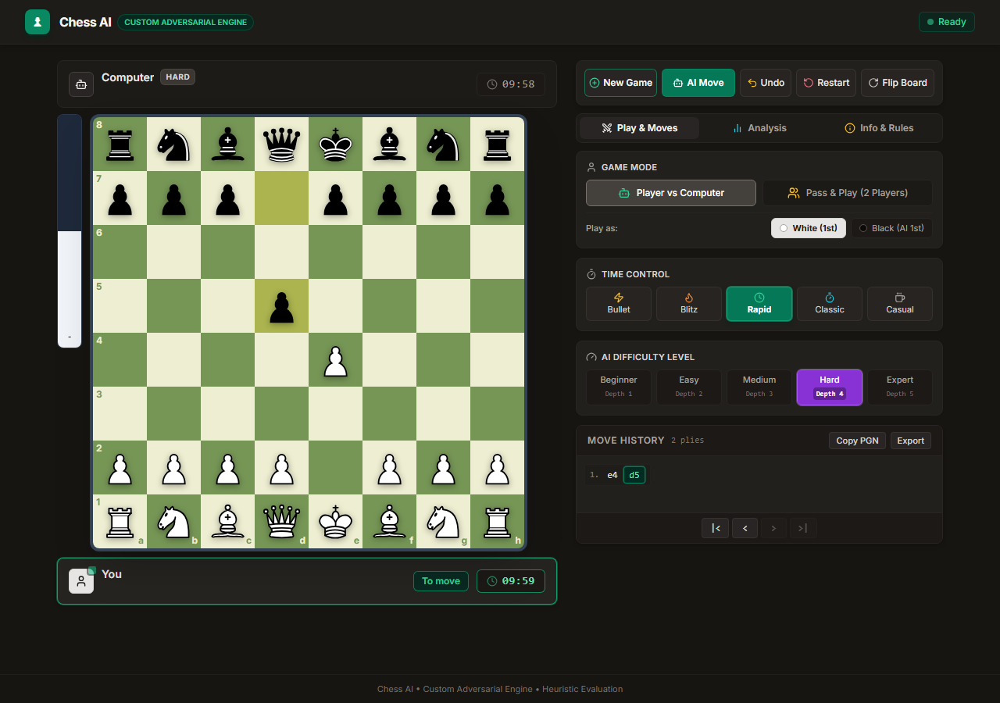

# ChessAI

A full-stack, tournament-grade chess web application powered by a custom-built, pure Python classical adversarial search engine.



---

## Overview

**ChessAI** is a web-based chess application featuring an adversarial artificial intelligence engine implemented from scratch in pure Python. The project demonstrates classical AI principles: depth-limited minimax search with alpha-beta pruning, iterative deepening, move ordering heuristics, quiescence search to mitigate the horizon effect, and transposition tables backed by 64-bit Zobrist hashing.

A modern, responsive React interface connects to a high-throughput FastAPI backend service, offering interactive gameplay, real-time position analysis, tournament chess clocks, move history navigation, and FIDE-compliant game arbitration.

---

## Key Features

- **Custom Adversarial Chess Engine**: Completely independent Python engine implementing Alpha-Beta pruning, iterative deepening, quiescence search, and a tapered 9-term heuristic positional evaluator.
- **Player vs Computer & Pass & Play**: Challenge the AI across 5 calibrated difficulty levels, or play against another human locally.
- **Tournament Time Controls**: 5 standard clock presets (Bullet 1m, Blitz 3m, Rapid 10m, Classical 30m, and Casual untimed) with authoritative backend clock synchronization and FIDE Article 6.9 timeout draw arbitration.
- **Strict Single-Ply Undo**: Step backwards exactly one half-move at a time in both Player vs AI and Pass & Play modes, allowing move review and alternative defense testing without resetting the match.
- **Deep Position Analysis**: Real-time evaluation bar with smooth sigmoid scaling, engine telemetry panel (depth, nodes, search time, nodes-per-second, TT metrics), and Principal Variation (PV) sequence extraction.
- **Interactive Move History**: Compact horizontal wrapping move log inspired by modern tournament platforms, with SAN notation, move-stepping controls (`|<`, `<`, `>`, `>|`), and one-click FIDE-standard PGN clipboard export.
- **On-Board Game-Over Modal**: Clear on-board outcome card displaying decisive results and draws (checkmate, timeout, stalemate, insufficient material, 50-move rule, threefold repetition), with seamless transition into post-game analysis or starting a new match.
- **Tournament Vector Artwork**: Bundled Colin M. L. Burnett (Cburnett) Staunton SVG pieces with high-contrast board themes.

---

## System Architecture

The application is structured into four decoupled layers:

```
┌────────────────────────────────────────────────────────┐
│               frontend/ (React + TypeScript)           │  Presentation Layer
│     Vite • Tailwind CSS • Lucide • Cburnett SVGs       │
└───────────────────────────┬────────────────────────────┘
                            │ HTTP JSON API
┌───────────────────────────▼────────────────────────────┐
│                  backend/ (FastAPI Web Service)        │  Orchestration & Validation
│    backend/api/          backend/game/ (python-chess)  │
└───────────────────────────┬────────────────────────────┘
                            │ Pure Python Internal Interface
┌───────────────────────────▼────────────────────────────┐
│                    engine/ (Pure Python)               │  Search & Heuristics
│    search/      evaluation/    optimization/   tuning/ │
└────────────────────────────────────────────────────────┘
```

### Role of `python-chess` vs Custom Engine
- **`python-chess` (Rules Arbiter)**: Used strictly in `backend/game/` as an immutable domain library to enforce legal move rules, manage board state, validate castling and en passant rights, parse FEN/PGN notations, and detect terminal game conditions.
- **Custom Engine (`engine/`)**: Independently evaluates chess positions and chooses all computer moves. It does **not** rely on `python-chess` for search, move selection, or evaluation math.

---

## Custom Chess Engine Implementation

### 1. Adversarial Search (`engine/search/`)
- **Minimax & Alpha-Beta Pruning**: Zero-window fail-soft search cutting off branches where $\alpha \ge \beta$.
- **Iterative Deepening**: Progressive search from depth 1 to nominal target depth or time limit. Safely preserves the Principal Variation from the deepest completed iteration.
- **Move Ordering**: Prunes search trees by sorting candidates before expansion:
  1. Transposition table hash move
  2. Winning and equal captures (ordered by MVV-LVA: Most Valuable Victim – Least Valuable Attacker)
  3. Pawn promotions
  4. Killer moves (quiet moves that caused recent beta cutoffs at the same ply)
  5. History heuristic table
  6. Remaining quiet moves
- **Quiescence Search**: At leaf nodes, extends search through capture and promotion sequences to eliminate the horizon effect. Includes full legal check evasions when the king is in check.
- **Transposition Table & Zobrist Hashing**: 64-bit polyglot random keys tracking piece positions, side to move, castling rights, and en passant targets. Caches exact, lower-bound, and upper-bound scores with replacement policies and mate-distance normalization.

### 2. Heuristic Positional Evaluation (`engine/evaluation/`)
The static evaluator computes integer scores in centipawns ($100\text{ cp} = 1\text{ pawn}$) from White's perspective using a tapered phase blending between middlegame and endgame terms:

$$\text{Score} = \text{phase} \times \text{Score}_{mg} + (1 - \text{phase}) \times \text{Score}_{eg}$$

Evaluated components include:
- **Material Balance**: Classical base values (Pawn: 100, Knight: 320, Bishop: 330, Rook: 500, Queen: 900 cp).
- **Piece-Square Tables (PST)**: Position-dependent bonuses interpolated continuously across game phases.
- **Mobility**: Safe move count and attack ray calculations.
- **Pawn Structure**: Independent evaluation of passed, protected, connected, doubled, isolated, backward, and blocked pawns without priority ladder masking.
- **King Safety**: Pawn shield completeness, semi-open/open files, and enemy attacking pressure in the king zone.
- **Center Control**: Occupation and control of the critical $d4, e4, d5, e5$ squares.
- **Piece Coordination**: Defended pieces, bishop pairs, and rooks on open files and 7th ranks.

### 3. Offline Parameter Optimization (`engine/tuning/`)
Includes a modular Genetic Algorithm (GA) utility for optimizing evaluation weight vectors offline against a balanced benchmark position suite.

---

## Technology Stack

- **Backend**: Python 3.12, FastAPI, Uvicorn, Pydantic, `python-chess`, AnyIO
- **Frontend**: React 18, TypeScript, Vite, Tailwind CSS, Lucide React
- **Testing**: pytest, pytest-cov, httpx, Vitest, React Testing Library
- **Artwork**: Colin M. L. Burnett Staunton SVG piece set (CC BY-SA 3.0 / GPL)

---

## Installation & Setup

### Prerequisites
- **Python**: Version 3.12+ installed
- **Node.js**: Version 18+ and `npm` installed

### 1. Clone the Repository
```bash
git clone https://github.com/USERNAME/ChessAI.git
cd ChessAI
```

### 2. Backend Setup
1. Create and activate a Python virtual environment:
   ```bash
   # Windows
   py -3.12 -m venv .venv
   .venv\Scripts\activate

   # Linux / macOS
   python3 -m venv .venv
   source .venv/bin/activate
   ```

2. Install dependencies:
   ```bash
   pip install -r requirements.txt
   ```

3. Start the FastAPI development server:
   ```bash
   uvicorn backend.main:app --reload --port 8000
   ```
   The backend API documentation will be accessible at [http://127.0.0.1:8000/docs](http://127.0.0.1:8000/docs).

### 3. Frontend Setup
1. In a separate terminal, navigate to the `frontend/` directory:
   ```bash
   cd frontend
   ```

2. Install dependencies:
   ```bash
   npm install
   ```

3. Start the Vite development server:
   ```bash
   npm run dev
   ```
   Open your browser at [http://localhost:5173](http://localhost:5173).

---

## Running Tests

### Backend Test Suite
Run unit, integration, and rule verification suites with `pytest`:
```bash
# Run all tests
pytest tests/unit/ tests/integration/

# Run with test coverage report
pytest --cov=engine --cov=backend tests/unit/ tests/integration/
```

### API Smoke Tests
Run end-to-end API scenario verification:
```bash
python scripts/smoke_test_api.py
```

### Frontend Test Suite
Run React component and integration tests with `vitest`:
```bash
npm test --prefix frontend
```

### Production Build
Verify TypeScript compilation and package bundling:
```bash
npm run build --prefix frontend
```

---

## Difficulty Profiles

| Difficulty | Search Depth | Quiescence Search | Time Budget | Behavior & Style |
|:---|:---:|:---:|:---:|:---|
| **Beginner** | Depth 0 | Depth 0 (Check evasion max 1) | Instant (< 50ms) | Evaluates immediate material and positional bonuses with check defense. |
| **Easy** | Depth 1 | Depth 2 (Captures & checks) | ~100ms | Basic tactical awareness, avoids simple one-move hanging pieces. |
| **Medium** | Depth 2 | Depth 4 (Captures & checks) | ~300ms | Solid club player; calculates short tactical exchanges and captures. |
| **Hard** | Depth 3 | Depth 6 (Captures & checks) | ~800ms | Deep positional calculation with move ordering and transposition table. |
| **Expert** | Depth 4 | Depth 8 (Captures & checks) | ~2000ms | Full search depth with iterative deepening, killer moves, and king attacks. |

---

## Project Structure

```
ChessAI/
├── backend/                      # FastAPI application & game management
│   ├── api/                      # REST endpoints & Pydantic schemas
│   ├── game/                     # Authoritative game service, clocks, rules
│   └── main.py                   # FastAPI entrypoint, middleware, CORS
├── engine/                       # Pure Python custom chess engine
│   ├── search/                   # Minimax, Alpha-Beta, ordering, TT, quiescence
│   ├── evaluation/               # Material, PST, king safety, pawns, mobility
│   ├── tuning/                   # Offline Genetic Algorithm weight optimizer
│   ├── config.py                 # Search and evaluation configuration dataclasses
│   ├── constants.py              # Centipawn constants and game-phase thresholds
│   └── difficulty.py             # Difficulty profiles and search resource bounds
├── frontend/                     # React + TypeScript + Vite web interface
│   ├── src/
│   │   ├── assets/pieces/        # 12 tournament Cburnett Staunton piece SVGs
│   │   ├── components/           # Board, PlayerCards, Clocks, Modal, History
│   │   ├── services/api.ts       # Backend REST API client
│   │   ├── types/chess.ts        # TypeScript schemas matching backend models
│   │   └── App.tsx               # Main application layout and state coordinator
│   ├── package.json              # Frontend dependencies and scripts
│   └── vite.config.ts            # Vite build configuration
├── tests/                        # Automated test suites
│   ├── unit/                     # 27 unit test suites for search, eval, rules
│   └── integration/              # FastAPI endpoints and full game flow tests
├── scripts/                      # Developer utilities
│   ├── smoke_test_api.py         # End-to-end API smoke test runner
│   ├── benchmark_difficulties.py # Performance and node-count benchmark suite
│   ├── run_ga_tuning.py          # Offline genetic algorithm weight optimizer
│   └── match_baseline_vs_tuned.py# Evaluation match runner
├── docs/                         # Technical documentation and screenshots
│   └── screenshots/              # UI screenshots for desktop and mobile
├── requirements.txt              # Constrained Python runtime dependencies
├── ARCHITECTURE.md               # Detailed system design, data flows, and contracts
├── REQUIREMENTS.md               # Functional and non-functional specifications
├── TESTING.md                    # Testing strategy and verification methodology
├── DECISIONS.md                  # Architecture Decision Records (ADRs)
└── LICENSE                       # Project license and third-party attribution
```

---

## Licensing & Third-Party Credits

- **Project Code**: Licensed under the [MIT License](LICENSE).
- **Chess Piece Artwork**: The Staunton vector chess pieces in `frontend/src/assets/pieces/` were created by **Colin M. L. Burnett** (Cburnett) and are licensed under the [Creative Commons Attribution-ShareAlike 3.0 Unported License](https://creativecommons.org/licenses/by-sa/3.0/) and the GNU General Public License (GPL). See [LICENSE](LICENSE) for full details.
